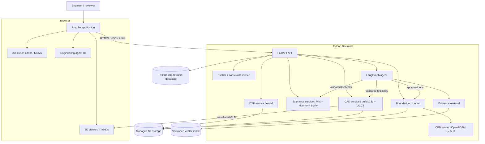
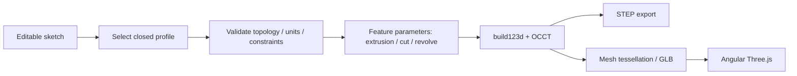

# Engineering Workbench — System Architecture

**Status:** Proposed architecture for review  
**Updated:** 2026-11-10  
**Scope:** Browser-based 2D DXF editing, tolerance analysis, parametric 3D CAD, engineering evidence agents, and optional CFD/GPU workflows.

> This document defines the proposed technical design. `PROJECT_PLAN.md` defines the delivery requirements; `AGENTS.md` defines instructions for coding agents; Architecture Decision Records (ADRs) record approved decisions. Where those documents disagree, do not silently override them: open an issue or ADR for review.

## 1. Goals and non-goals

### Goals

1. Provide an Angular browser application to **import, view, draw, edit, measure, and export 2D DXF drawings**.
2. Keep an **editable, versioned internal sketch model** separate from DXF interchange data.
3. Provide a validated Python tolerance-analysis service with worst-case, RSS, and seeded Monte Carlo calculations.
4. Convert **explicitly selected, validated closed 2D profiles** into parametric 3D solids using build123d/OpenCASCADE; support STEP import/export.
5. Render 3D models with Three.js using tessellated meshes while keeping precise engineering geometry on the backend.
6. Add a source-grounded, approval-aware engineering AI agent layer in Week 5 and a reproducible CFD workflow in Week 6.
7. Ensure traceability, deterministic tests, secure file processing, reproducible builds, and clean-room open-source provenance.

### Non-goals for the initial release

- Full AutoCAD, FreeCAD, or SolidWorks feature parity.
- Guaranteed conversion of arbitrary multi-view DXF/PDF/raster engineering drawings into complete 3D solids.
- Treating dimension annotations as automatically enforceable geometric constraints.
- Browser-side CAD kernel or unrestricted arbitrary Python/CAD code execution.
- Automatically certifying GD&T, PMI, simulation results, or manufacturability.

## 2. Architecture principles

- **Separation of concerns:** Angular owns interaction; FastAPI owns file validation, persistence, and engineering services.
- **Geometry vs. presentation:** A drawing is a model of entities and constraints, not merely pixels on a canvas. Three.js/Konva visual output is not authoritative geometry.
- **Engineering correctness:** Units, tolerances, revisions, provenance, and assumptions are explicit. Never infer an unspecified dimension as a verified measurement.
- **Interchange vs. native state:** DXF and STEP are interchange formats. Native JSON/database state preserves stable entity IDs, edit commands, feature intent, and revision history.
- **AI as orchestrator:** Agents call deterministic, validated services and must not fabricate geometry, calculations, or sources.
- **Incremental delivery:** Start with a narrow working editor and tolerance engine before adding CAD, agents, CFD, and GPU services.
- **Clean-room development:** Research public functionality and permitted OSS; do not copy protected UI/source or upload confidential CAD without authorization.

## 3. Technology choices

| Layer | Proposed technology | Responsibility | Stage |
|---|---|---|---|
| Frontend | Angular + TypeScript | Routes, forms, application state, project UI | Weeks 1–2 |
| UI | Angular Material | Toolbars, dialogs, property panels, tables | Weeks 1–2 |
| 2D editing | Konva.js | Canvas interaction, pan/zoom, handles, selections | DXF MVP |
| DXF preview | Optional `vagran/dxf-viewer` | Reference viewer for supported DXF entities; not an editor | DXF MVP evaluation |
| Backend | FastAPI + Pydantic | Typed REST endpoints, uploads, errors, schemas | Week 1 |
| DXF I/O | ezdxf | Read/write DXF entities, layers, annotations | DXF MVP |
| 2D geometry | NumPy, Shapely where appropriate | Geometric predicates, distances, intersections | Weeks 1–2 |
| Constraints | SymPy + SciPy | Constraint expressions and numerical solving | Week 2 |
| Units | Pint | Dimensional analysis and conversion | Week 1 |
| Tolerance analysis | NumPy + SciPy | Worst-case, RSS, Monte Carlo, optimization | Weeks 1–2 |
| Parametric 3D | build123d on OpenCASCADE/OCCT | B-Rep solids, booleans, volumes, STEP I/O | Weeks 3–4 |
| 3D visualization | Three.js | Display GLB/glTF or another approved tessellated format | Weeks 3–4 |
| Database | PostgreSQL (proposed) | Projects, revisions, entities, audit metadata | Add when needed |
| File storage | Local managed directory initially; object storage later | DXF, STEP, mesh, reports | Progressive |
| Background work | Bounded worker process; Celery + Redis if needed | CAD/CFD jobs, cancellation, resource caps | Weeks 3–6 |
| Agent orchestration | LangGraph | Planning, tool routing, checkpoints, approval | Week 5 |
| Retrieval | LanceDB or Qdrant (decision pending) | Versioned engineering evidence search | Week 5 |
| CFD | OpenFOAM or SU2 (decision pending) | Reproducible numerical simulation | Week 6 |
| GPU experiments | NVIDIA Warp, optional PhysicsNeMo | Measured acceleration or surrogate experiments | Week 7 |
| Deployment | Docker Compose, reverse proxy | Reproducible local development and deployment | Progressive |

**Decision status:** The technologies above are recommendations, not proof that an ADR has been accepted. Review dependency licenses and versions before adoption. In particular, do not assume a DXF viewer supports every entity or that a mesh round-trips to exact B-Rep geometry.

## 4. Logical architecture



The 2D editor uses its own normalized geometry state. The backend exports DXF and validates imported DXF. Browser rendering does **not** imply that all DXF entity semantics have been preserved.

## 5. Repository layout

```text
engineering-workbench/
├── AGENTS.md
├── ARCHITECTURE.md
├── PROJECT_PLAN.md
├── README.md
├── compose.yaml
├── frontend/
│   ├── package.json
│   └── src/app/
│       ├── core/
│       │   ├── api/
│       │   └── state/
│       ├── features/
│       │   ├── dxf-editor/
│       │   │   ├── components/
│       │   │   ├── tools/
│       │   │   ├── models/
│       │   │   └── services/
│       │   ├── tolerance/
│       │   ├── cad-viewer/
│       │   ├── projects/
│       │   └── agent-chat/
│       └── shared/
├── backend/
│   ├── pyproject.toml
│   ├── app/
│   │   ├── main.py
│   │   ├── api/
│   │   │   ├── drawings.py
│   │   │   ├── sketches.py
│   │   │   ├── tolerance.py
│   │   │   ├── cad.py
│   │   │   ├── jobs.py
│   │   │   └── agents.py
│   │   ├── schemas/
│   │   ├── services/
│   │   │   ├── dxf/
│   │   │   ├── sketch/
│   │   │   ├── tolerance/
│   │   │   ├── cad/
│   │   │   └── simulation/
│   │   ├── agents/
│   │   │   ├── graph.py
│   │   │   ├── state.py
│   │   │   ├── tools/
│   │   │   └── prompts/
│   │   ├── persistence/
│   │   └── security/
│   └── tests/
│       ├── dxf/
│       ├── sketch/
│       ├── tolerance/
│       ├── cad/
│       └── agents/
├── docs/
│   ├── adr/
│   ├── logs/
│   ├── api/
│   ├── provenance/
│   └── validation/
├── examples/
│   ├── dxf/
│   ├── tolerance/
│   └── cad/
└── scripts/
```

Directories are planned boundaries, not a requirement to create empty packages on Day 1. Add code only when the corresponding feature is implemented.

## 6. DXF editor: core design

### 6.1 User workflow

1. User creates a new sketch or uploads a `.dxf` file.
2. FastAPI checks file size/type and parses DXF in a restricted process with ezdxf.
3. Supported DXF entities are normalized into the application's editable sketch schema; unsupported entities are reported, not silently discarded.
4. Angular renders normalized geometry using Konva.js and displays layers, properties, and dimensions.
5. User selects, draws, moves, rotates, trims (when implemented), deletes, measures, or changes geometry.
6. Commands update local state and undo/redo history. Save sends a validated revision to FastAPI.
7. Export regenerates DXF from the internal model and reports any entity/annotation loss or unsupported semantics.

### 6.2 Initial supported entities

**MVP:** `LINE`, `CIRCLE`, `ARC`, `LWPOLYLINE` (including closed profiles), basic layers, units, and selected `TEXT`/`MTEXT`/`DIMENSION` display as supported by the chosen implementation.

**Later:** blocks/inserts, splines, hatches, leaders, advanced dimension styles, external references, complex transforms, and robust annotation editing. Each entity type must have a documented import/export support level.

### 6.3 Native sketch data model

A normalized sketch revision includes:

- `project_id`, `sketch_id`, `revision_id`, `schema_version`, and `units`.
- Stable `entity_id`, `type`, geometry parameters, `layer_id`, style, and source DXF handle when available.
- Explicit dimensional constraints and geometric constraints **separate** from rendered dimension annotations.
- Coordinate system, drawing plane, origin, and transformations.
- Source provenance, warnings, unsupported entities, and import metadata.
- An append-only revision history and command log or snapshots for undo/redo and audit.

Illustrative API payload:

```json
{
  "schema_version": 1,
  "units": "mm",
  "plane": "XY",
  "entities": [
    {"id": "line-1", "type": "line", "layer": "geometry", "start": [0, 0], "end": [100, 0]},
    {"id": "circle-1", "type": "circle", "layer": "geometry", "center": [50, 30], "radius": 10}
  ],
  "constraints": [],
  "warnings": []
}
```

The example is a sketch payload, **not** a complete DXF document. DXF import must preserve or report units and relevant entity metadata. Units absent in a DXF must trigger an explicit user choice rather than a silent millimeter assumption.

### 6.4 Geometry and editor correctness

- Define world-to-screen transforms and keep drawing coordinates independent of zoom/pan.
- Support snapping with tolerance expressed in screen pixels, then convert appropriately to model coordinates.
- Measure using model-space coordinates and explicit units, not pixel lengths.
- Use stable IDs for entity selection, edit commands, and revision comparisons.
- Detect self-intersections and invalid/ambiguous closed profiles before extrusion.
- Validate constraints, residuals, degrees of freedom, and non-convergence; do not claim a sketch is fully constrained based only on dimension labels.
- Preserve unsupported DXF content only if a verified round-trip strategy exists; otherwise report loss before save/export.

### 6.5 Implemented annotation subset (2026-11-10)

See [ADR-001](ADR.md) and the [annotation guide](docs/annotations.md). The current implementation lives in `frontend/src/app/dxf/` and `backend/app/dxf/`, preserving the existing Angular/Konva/FastAPI/ezdxf stack rather than creating the proposed directory tree prematurely.

The native schema now has separate `entities` and `annotations`, explicit deduplicated `layers`, and persistent `hidden_layers`. Every drawing includes `Geometry` and `ASME Y14.5`. The latter is a dedicated annotation layer, not a claim of ASME certification. Legacy browser sketches receive default empty annotation state during load.

Annotations have stable IDs, a restricted type, geometry references, derived nominal measurements, explicit units/precision/style, placement and collision state, creation mode, optional asymmetric tolerance and separate text override, plus revision/update metadata. Deterministic TypeScript calculations synchronize values and flag invalid or orphan references; manual positions remain fixed. Geometry and annotations share snapshot undo/redo and browser save/restore. This is implemented local persistence; the server-backed revision store described above remains proposed.

Auto Dimension handles circles (diameter), arcs (radius), lines (horizontal, vertical or aligned), closed-profile bounding extents and isolated axis-aligned four-line rectangles. Manual tools add radius, diameter, projected/aligned and two-line angular dimensions. Parallel/coincident/zero-length angular pairs are rejected. Closed polylines are treated as bounding profiles, not assumed rectangles. Dimensions never become geometric constraints.

Konva renders annotation lines, leaders, extensions, arrows and labels without adding geometry entities. Deterministic placement tries increasing offsets and reports approximate label-box collisions. Leaders may still overlap and require manual adjustment. Label and arrow pixel clamps preserve readability without changing model measurements. Layer visibility, manual placement, precision, styles, explicit tolerances and visibly marked overrides are editable.

Python validates measurements independently of client-provided nominal values before DXF export. Existing endpoints exchange real DXF DIMENSION entities with anonymous graphical blocks for linear/aligned/radius/diameter/two-line-angular cases. T360 XDATA preserves validated native geometry/annotation links. External dimensions with unambiguous supported references and unit-scale styles are imported; unsupported or ambiguous definitions/styles receive warnings. Export rejects invalid/orphan annotations and unspecified drawing units. No speculative annotation inference, design tolerances, GD&T, datums or certification are implemented.

## 7. 2D-to-3D CAD workflow



- Only validated profiles and explicitly chosen operations create solids.
- An arbitrary DXF engineering sheet with orthographic views, hidden lines, and annotations is **not** automatically an extrudable profile.
- Store a feature graph with named dimensions, parameters, feature IDs, dependencies, and revision references.
- Use OCCT geometry for volume, bounding boxes, validity, distances, and interference; never calculate authoritative engineering clearances from display triangles.
- Record tessellation settings and acknowledge visual approximation.
- STEP preserves precise exchange geometry, but does not necessarily preserve the source application's feature history.
- STEP AP242 PMI/GD&T support must be capability-tested. Reject unsupported semantic interpretations rather than guessing.

## 8. Tolerance-analysis service

### Inputs

- Nominal dimensions, signed direction coefficients, asymmetric plus/minus tolerances, unit, source, and revision.
- Distribution assumptions for statistical methods, optional correlation information where supported, sample count and seed.
- Optional acceptance specification for failure probability.

### Outputs

- Nominal signed stack result.
- Worst-case minimum and maximum using correct sign-aware asymmetric propagation.
- RSS only under explicitly documented assumptions; no confusion with worst-case bounds.
- Seeded Monte Carlo percentiles, distribution summary, and probability of exceeding a specified limit.
- Sensitivity ranking, assumptions, warnings, reproducibility metadata, and calculation trace.

### Mandatory Week 1 reference fixture

| Component | Nominal (mm) | Tolerance (mm) | Sign |
|---|---:|---:|---:|
| Housing | 20.00 | ±0.12 | +1 |
| Shaft | 10.00 | ±0.05 | −1 |
| Spacer | 9.80 | ±0.08 | −1 |

Expected nominal: **+0.20 mm**.  
Expected worst-case interval: **[−0.05, +0.45] mm**.  
Expected RSS **3σ half-width ≈ 0.153 mm**, **only** if the stated ± component tolerances each represent independent centered Gaussian 3σ intervals.  
Monte Carlo: **100,000 samples with fixed seed** for the assignment's reference verification. Negative clearance denotes interference.

Engineering tests must independently verify at least three fixtures, including asymmetric tolerances, negative coefficients, and incompatible units.

## 9. Proposed API surface

API versioning: `/api/v1`. These endpoints are proposed contracts, not implemented features.

| Method | Path | Purpose |
|---|---|---|
| `POST` | `/api/v1/drawings/import-dxf` | Upload DXF and receive normalized sketch + warnings |
| `POST` | `/api/v1/drawings/export-dxf` | Export validated sketch as DXF |
| `GET` | `/api/v1/projects/{project_id}/sketches/{sketch_id}` | Read sketch revision |
| `PUT` | `/api/v1/projects/{project_id}/sketches/{sketch_id}` | Save validated sketch revision with concurrency check |
| `POST` | `/api/v1/sketches/validate` | Check entities, units, constraints and closed profiles |
| `POST` | `/api/v1/tolerance/calculate` | Worst-case, RSS, Monte Carlo |
| `POST` | `/api/v1/cad/generate` | Generate 3D from validated feature parameters |
| `POST` | `/api/v1/cad/inspect-step` | Inspect STEP geometry and report unsupported metadata |
| `GET` | `/api/v1/cad/models/{model_id}/mesh` | Retrieve browser display mesh |
| `GET` | `/api/v1/cad/models/{model_id}/step` | Retrieve precise STEP export |
| `POST` | `/api/v1/jobs/cfd` | Queue validated, bounded CFD case (Week 6) |
| `GET` | `/api/v1/jobs/{job_id}` | Retrieve status, logs, outputs |
| `POST` | `/api/v1/agents/runs` | Start controlled engineering agent workflow (Week 5) |
| `POST` | `/api/v1/agents/runs/{run_id}/approve` | Human approval for gated action |

All endpoints use Pydantic request/response schemas, structured errors, stable identifiers, and documented units. Upload endpoints apply file size, count, time, and storage quotas. Use generated OpenAPI types for Angular where practical.

## 10. AI agent architecture (Week 5)

`backend/app/agents/` contains application AI code. Root `AGENTS.md` is **Codex/developer instruction documentation**, not runtime agent implementation.

Agent workflow:

1. Retrieve versioned evidence with source IDs, hashes, and citations.
2. Parse user intent and required engineering parameters.
3. Validate units, revisions, authorization, and tool inputs.
4. Route to allowlisted deterministic tolerance/CAD/CFD services.
5. Pause for human approval when ambiguity, cost, risk, or unsupported claims require it.
6. Verify outputs against tool results and report assumptions and uncertainties.
7. Store replayable trace, source references, tool versions, approval record, and result.

Agent safeguards:

- Never execute untrusted arbitrary Python, shell, or CAD scripts from model output.
- Never fabricate a numerical engineering result, STEP feature, source, or simulation outcome.
- Abstain when PMI/GD&T semantics, dimensions, units, or source revisions cannot be verified.
- Use least-privilege access to project files and isolate confidential drawings.
- Evaluate retrieval, abstention, latency, tool failures, and at least five replayable traces.
- Keep agent outputs advisory; engineering signoff remains a human responsibility.

## 11. CFD and GPU (Weeks 6–7)

CFD runs through a restricted, asynchronous worker, not the HTTP request thread. The runner uses fixed solver images, parameter allowlists, resource/time limits, and structured output artifacts. Store mesh, boundary conditions, solver version, convergence logs, plots, and numerical validation. Compare a laminar channel case with the analytical Poiseuille profile and perform a mesh-refinement study. A refined-profile target below 5% error is conditional on documented discretization, entrance conditions, and validation setup.

GPU experiments (e.g. NVIDIA Warp) compare numerical agreement and measured runtime against a CPU baseline, including warm-up and transfer overhead. If hardware or dependencies are unavailable, record a transparent no-go or fallback; do not invent speedups.

## 12. Persistence and revision model

Proposed entities:

- `Project`: owner/access scope, created/updated timestamps.
- `Drawing`: source file reference, format, units, import warnings.
- `SketchRevision`: immutable geometry snapshot, constraint state, schema version, source hash.
- `CadFeatureRevision`: named features, parameters, source sketch revision, generated artifacts.
- `ToleranceRun`: input hash, units, assumptions, seed, results, calculation version.
- `SimulationJob`: case definition, solver version, status, limits, artifact references.
- `AgentRun`: retrieved source versions, tool calls, checkpoints, approvals, outputs.

Use optimistic concurrency (revision token or ETag) for saves. Keep original DXF files, normalized editable sketches, and exported DXF distinct. Store large binaries outside database rows. Add migrations and access controls before multi-user deployment.

## 13. Security and reliability

- Validate content and file signatures where possible; never trust filename extensions alone.
- Restrict DXF/STEP size, parsing time, entity count, nesting, and memory; sandbox potentially expensive import operations.
- Prevent path traversal, unsafe external references, archive extraction issues, and unrestricted outbound access.
- Enforce authentication/authorization before production or multi-user deployment.
- Set explicit CORS origins; apply rate limits, quotas, and audit logging.
- Never include secrets in Git, logs, generated CAD artifacts, or AI prompts.
- Do not send customer CAD/drawings to third-party AI without explicit authorization.
- Separate generated code from execution: use vetted operations/parameters and sandbox any approved code execution.
- Protect long-running CAD/CFD tasks with timeouts, cancellation, retries only when safe, and resource limits.
- Treat imported drawing dimensions as annotations until independently validated against actual geometry and units.

## 14. Testing and acceptance

### Unit tests

- DXF entity conversion, units, layers, coordinates, and supported/unsupported cases.
- World/screen coordinate transforms, snapping, selection, undo/redo, revision conflicts.
- Geometry validation: open/closed loops, self-intersections, invalid arcs, non-finite coordinates.
- Tolerance calculations, sign reversal, asymmetry, unit incompatibility, seeded Monte Carlo.
- CAD solid validity, volume, bounding box, STEP round-trip, topology-change handling.

### Integration tests

- Import DXF → edit sketch → save revision → export DXF → re-import and compare supported geometry.
- Create closed profile → generate CAD → export STEP → re-import and compare geometric invariants.
- API validation and clear failure behavior for malformed, unsupported, or excessive files.
- Agent tool-call schema checks, human approval, citation grounding, and recovery.
- CFD mesh/BC audit and independent analytical comparison.

### Week 1 gate

- Working standalone 1D tolerance API and compact interactive calculator.
- At least **30 meaningful tests** and **three independently verified calculation fixtures**.
- Reproducible setup, CI, architecture/assumption documentation, and an **eight-minute demo**.

The DXF editor is a proposed parallel product capability. It must not displace the mandatory Week 1 tolerance-analysis acceptance gate without an explicit scope change.

## 15. Delivery roadmap

| Period | Primary deliverable | Architecture emphasis |
|---|---|---|
| Week 1 | Validated 1D tolerance calculator and API | Schemas, Pint, pytest, CI, documentation |
| Week 2 | 2D constraints, mechanisms, sensitivity and optimization | SciPy/SymPy; optional initial DXF viewer/editor spike |
| Week 3 | Parametric bracket/spacer/shaft, STEP import/export | build123d, OCCT, 3D viewer |
| Week 4 | Feature binding, revision comparisons, GD&T capability matrix | Traceability, geometry tests, abstention |
| Week 5 | Versioned retrieval + LangGraph engineering agent | Agent tools, approval, evidence and replay |
| Week 6 | Reproducible CFD service | Worker isolation, analytical validation |
| Week 7 | GPU/physics-AI experiment | Measured accuracy, runtime, fallback |
| Week 8 | Integrated demos, adverse tests, deployment review | Reliability, security, final assessment |

**DXF editor MVP (proposed separate track):** import/view simple DXF → normalized sketch state → draw/select/move/delete → save/export DXF → dimensions/snapping → validated closed-profile extrusion. Schedule this work explicitly rather than assuming it is part of the original daily acceptance criteria.

## 16. Architecture decisions to record

Suggested ADR topics (all **proposed** until accepted):

1. Angular + FastAPI as application boundaries.
2. Konva.js for interactive 2D sketch editing; evaluate DXF viewer separately.
3. ezdxf for DXF import/export and internal JSON as editable native state.
4. Pint for mandatory engineering unit validation.
5. build123d/OCCT for server-side B-Rep geometry and STEP processing.
6. Three.js for mesh visualization, with geometry calculations on the server.
7. PostgreSQL and managed file storage when persistent projects are required.
8. LangGraph as a bounded orchestration layer, separate from deterministic services.
9. OpenFOAM vs SU2 and LanceDB vs Qdrant selection based on measured requirements.
10. OpenCascade.js as a **future alternative** to backend CAD operations, not a required second kernel.

Each ADR should state context, alternatives, decision, trade-offs, status, and verification criteria. Do not record an unmade decision as accepted.

## 17. External technical references

- Angular: https://angular.dev/
- Angular Material: https://material.angular.dev/
- Konva.js: https://konvajs.org/docs/
- DXF viewer reference: https://github.com/vagran/dxf-viewer
- ezdxf: https://ezdxf.readthedocs.io/
- FastAPI: https://fastapi.tiangolo.com/
- Pydantic: https://docs.pydantic.dev/latest/
- Pint: https://pint.readthedocs.io/
- SymPy: https://docs.sympy.org/latest/
- SciPy: https://docs.scipy.org/doc/scipy/
- NumPy: https://numpy.org/doc/stable/
- build123d: https://build123d.readthedocs.io/
- OpenCASCADE: https://dev.opencascade.org/
- Three.js: https://threejs.org/docs/
- LangGraph: https://docs.langchain.com/oss/python/langgraph/overview
- OpenFOAM: https://www.openfoam.com/documentation/tutorial-guide
- SU2: https://github.com/su2code/SU2
- NVIDIA Warp: https://github.com/NVIDIA/warp

## 18. Definition of architectural readiness

The architecture is ready for implementation when:

- The project plan, `AGENTS.md`, and accepted ADRs do not contradict this document.
- Week 1 acceptance criteria and engineering verification methods are explicit.
- The supported DXF entity list, native sketch schema, and import/export loss policy are agreed.
- API schemas, file-size limits, coordinate conventions, and unit conventions are documented.
- Browser rendering and authoritative geometry/calculation responsibilities are unambiguous.
- Licensing, provenance, data privacy, and execution boundaries are reviewed.

**Next action:** Review this proposal with Codex against the existing repository. Resolve conflicts via ADRs before generating substantial code.

## Implemented CAD-to-tolerance bridge (2026-11-10)

The existing editor and tolerance page are connected by `CadDraftService` and the additive `CadFeatures` section. The native `Sketch` now carries a drawing ID and captured revision; legacy browser sketches receive defaults. The shared service snapshots unsaved geometry/annotations, persists the working sketch and engineering draft in browser localStorage, and provides source selections when returning to the editor. This is local persistence, not the proposed server project/revision archive.

`backend/app/cad_analysis.py` independently extracts normalized measured features from the existing Pydantic sketch. The stateless `/api/v1/analysis/import-drawing` and `/api/v1/analysis/calculate` endpoints validate source signatures, revisions, review, engineering relationships and Pint length conversion. Draft reads/edits use browser persistence. No duplicate geometry or calculation engine was introduced: the original engine moved into `backend/app/tolerance.py`, with additive asymmetric bounds and worst-case-only support; the existing endpoint retains its symmetric defaults.

Supported sources include XY LINE/CIRCLE/ARC, straight LWPOLYLINE/2D POLYLINE, bounded transformed INSERT geometry and the existing supported linked DIMENSION subset. Geometry, explicit dimensions, explicit tolerances, text overrides and reviewed user specifications remain separate. Missing tolerances never default to zero. Stale/changed sources require refresh/review; unchanged feature meaning permits preservation of user tolerances. Result traces identify the exact drawing snapshot. See [workflow, API, units, revision behavior and limitations](docs/cad-tolerance-workflow.md) and ADR-002.


The subsequent automatic relationship workflow (ADR-003) generates the signed formula from current selected rows and coefficients. Calculation with no selection selects available valid features with explicit tolerance bounds. Routine formula/specification approval gates are removed from this UI at the user's request; changed-source/override review and engineering validation remain. Server automatic mode constructs the relationship from validated terms; legacy manual API mode retains its prior contract.

## Implemented presentation system (2026-11-10)

The Angular shell now uses `WorkbenchHeader`, a workspace navigation rail and real browser-local Dashboard/Settings pages. Existing `#dxf`/`#tolerance` navigation remains valid. `design-tokens.scss` centralizes semantic colors, typography, contrast-aware control/feedback states, spacing and motion. Shared SVG icons, empty/loading/error states and scoped control primitives complement the existing Angular Material controls. UI preferences are isolated from native drawing/draft storage.

The existing CAD editor remains authoritative for geometry. Collapsible panels, entity exploration, hover cues, view-only zoom buttons and save-status display are presentation additions. A CSS-to-Konva adapter supplies rendering colors without changing native entity/annotation serialization. Existing tolerance services and FastAPI contracts are unchanged. See [UI design system and limitations](docs/ui-design-system.md).
